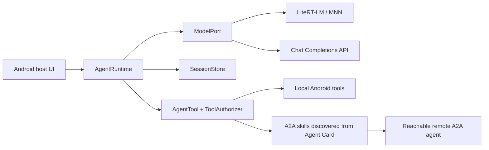

<p align="center"></p>

# Kiora

**English** | [简体中文](README.md)

Kiora is an experimental Kotlin agent framework for Android. It connects **on-device LiteRT-LM and MNN models**, optional Chat Completions-compatible APIs, local tools, persistent sessions, and **A2A agent collaboration** through a small runtime. The `core` module is pure Kotlin/JVM; Android UI, platform permissions, and data policy belong to the host application. The API may change while the project is experimental.

The code is licensed under [Apache-2.0](LICENSE). Model weights, optional native AARs, and third-party integrations have their own licenses and are not bundled with the repository.



## Modules

| Module | Responsibility |
| --- | --- |
| `core` | Bounded model/tool loop, cancellation, active tool selection and authorization, basic JSON Schema argument validation, host-facing structured tool output and output Schema validation, input/authorization attention states, session branches, persistence, context protection and compaction, usage metadata, queued instructions, images, and runtime events. Optional `WorkspaceTools` are provided separately. |
| `a2a` | A2A 1.x client: Agent Card discovery, skill-to-tool mapping, HTTP+JSON and JSONRPC, task send/poll/resume/cancel, text, JSON data and inline files, Bearer credentials, and cross-task `contextId`. |
| `android-attachments` | Read authorized Android `content://` files and photos into size-bounded A2A attachments. |
| `android-storage-tools` | Tools for files in Storage Access Framework (SAF) directories explicitly authorized by the host. |
| `android-code-sandbox` | Optional restricted JavaScript execution in a separate Android process. |
| `model-chat` | Chat Completions-compatible providers, text and function tools, image results, and SSE streaming. |
| `model-litert` | Load `.litertlm` models directly on Android, with CPU/GPU selection, streamed text, optional single-image input, and tool calls. GPU support depends on the model and device. |
| `model-mnn` | Load an MNN model directory inside the Android app process. Supports text, configured vision models, streaming, cancellation, and Kiora's authorized tool loop. Currently packages `arm64-v8a` only. |
| `embedding` / `embedding-mediapipe` | Embedding interface, vector checks and similarity; optional EmbeddingGemma 2 text/image adapter using MediaPipe Universal Embedder. |
| `face` / `face-onnx` | UI-independent face contracts, multi-sample enrollment, host-supplied storage and 1:N matching; optional Android SCRFD detection, five-point alignment and MobileFaceNet features. |
| `speech` / `speech-sherpa-onnx` | UI-independent transcription and synthesis contracts; optional SenseVoice Small int8 ASR and MeloTTS FP32/int8 Android adapters. |
| `speech-tools` | Optional `speak_text` agent tool with host-supplied synthesis and playback. |
| `document-ocr` / `document-ocr-mlkit` / `document-ocr-paddle` | OCR contract and optional Android ML Kit or PP-OCRv6 adapters. |
| `sample` / `android-demo` | Offline JVM example and Android app for exercising model, tool, authorization, and A2A paths. |

The [Kiora Companion](https://github.com/qhvssonic/kiora-companion) app uses these modules in a fuller Android product. Its scanning, gallery, settings, and chat UI are host features, not automatic SDK features.

Offline TTS uses sherpa-onnx 1.13.8 and Chinese/English MeloTTS. FP32 is recommended after target-device measurements; int8 import remains supported. Companion provides manual reply playback and stop controls without registering `speak_text`; other hosts may opt into `speech-tools`. Model assets are imported separately. See the [offline synthesis guide](docs/speech-synthesis.md) for device results and remaining validation. Dialect-focused Fun-ASR-Nano remains a future ASR candidate.

Local face recognition uses one host-supplied ONNX Runtime Android dependency and separately imported weights. Companion 0.1.103 adds enrollment, live preview scans that query automatically, and an incremental photo index. Preview frames stay in memory and templates remain in the app's private database. No face tools or uploads are enabled automatically. See [integration and limitations](docs/face-recognition.md), including model licensing and uncalibrated matching thresholds.

## How a run works

The host supplies a `ModelPort`, `SessionStore`, enabled `AgentTool`s, and a `ToolAuthorizer`. On each turn, `ActiveToolSelector` chooses which tools are visible to the model. A proposed tool call is checked before authorization and execution; its actual result is stored and returned to the model. A call request is not proof that the operation succeeded. Each run has limits on model turns, tool calls, and elapsed time; cancellation propagates but cannot undo actions already performed.

`ModelPort` keeps the runtime independent of a specific inference engine. A host may use `ChatCompletionModelPort`, `LiteRtModelPort`, `MnnModelPort`, or its own adapter. Model packages still determine the real context length, vision capability, tool-call quality, and resource use. The embedding interface is separate from the chat model interface: generating gallery vectors is not the same operation as asking a vision model to inspect an image.

### Tools and permissions

`WorkspaceTools(directory).all()` is optional and is never registered automatically:

| Tool | Scope |
| --- | --- |
| `read` | UTF-8 text under the configured workspace; files are limited to 1 MiB and returned text to 32 KiB. |
| `write` | Create or replace a UTF-8 workspace file, up to 1 MiB of content. |
| `edit` | Replace exactly one matching span in a workspace file. |
| `shell` | Start a command from the workspace directory, with command/output/time limits. It runs with the host process's OS permissions and **is not confined to the workspace**. |

Android system permissions, SAF grants, and the host's tool authorization remain separate checks. A model-generated filename does not prove a file exists. When sending an attachment, the host should map a controlled file ID to an existing authorized file, validate its source and size before prompting for upload permission, and read its bytes only after authorization. An Android `content://` URI is local to the authorized app; it is not a remote file URL.

Images may be supplied with `AgentRuntime.run(..., images = ...)` or returned by a tool through `ToolOutput`/`ToolImage`, if the current model adapter accepts them. The current LiteRT-LM integration passes one image per turn. Image handling by other models depends on their packages and adapters.

### Sessions and context

The runtime stores the original, branch-aware conversation. The model-facing projection can use a persistent summary and retain recent turns; it can also shorten old tool results without deleting the stored originals. A host may configure `AutoCompaction` with its own resource budget. If summarization fails, a configured context-window crop is a fallback. Token estimates include text, tools, and image overhead, but are not exact tokenizer counts; leaving the window unknown does not make the runtime invent a model limit. A model-reported overflow can trigger one retry with a smaller input.

Steering and follow-up input can be queued during a run. A tool may report that user input or authorization is required, allowing the host to pause and resume the task. Persisting a local conversation is distinct from preserving a remote A2A task.

## A2A collaboration

Kiora discovers a target through its Agent Card. Each advertised skill becomes a separate model tool. A skill that declares a file MIME input may expose `files` when the host supplies a file loader; a skill that declares `application/json` may expose `form`. A text-only skill is not treated as a file-transfer endpoint. A skill is a capability description, not a custom RPC method: execution still uses A2A messages and tasks.

For the first remote task, the host may omit `contextId`. If the target returns one, the host should retain it for the pair of local session and remote connection and send it with later tasks. `taskId` resumes a particular unfinished task; it does not replace `contextId` for continuity across completed tasks. The target may be on a computer, server, or another reachable device.

The client currently supports A2A 1.x HTTP+JSON and JSONRPC, polling, cancellation, and inline attachments totaling at most **10 MiB**. It does not provide A2A SSE, remote-file downloads, push notifications, large-file streaming, or a full A2A server. The remote agent must actually implement the skill it advertises, and the network path must be reachable. Authorization controls transmission from the phone; once an attachment reaches the recipient, that agent can read it according to its own task and permissions.

The current response decoder extracts text parts only; remote JSON and file parts are not retained as usable artifacts. Canceling local waiting does not automatically call the peer's task cancellation endpoint.

## Build and try the SDK

Requirements: **JDK 17** and, for the default build, an Android SDK with `compileSdk 35`. Configure `sdk.dir` in `local.properties` or use the usual Android SDK environment variables. The repository includes a Gradle Wrapper:

```powershell
.\gradlew.bat test
.\gradlew.bat :sample:run
.\gradlew.bat :android-demo:assembleDebug
```

For the pure Kotlin/JVM modules only, use `-PskipAndroid=true`. The optional `speech-sherpa-onnx` and `document-ocr-paddle` modules need locally prepared AAR repositories and their respective `-PsherpaLocalRepo=...` and `-PpaddleLocalRepo=...` properties.

Publish the SDK modules needed by another local Android project before building that host:

```powershell
.\gradlew.bat :core:publishToMavenLocal :a2a:publishToMavenLocal :model-chat:publishToMavenLocal :model-mnn:publishToMavenLocal :model-litert:publishToMavenLocal :android-attachments:publishToMavenLocal :android-storage-tools:publishToMavenLocal :android-code-sandbox:publishToMavenLocal
.\gradlew.bat :document-ocr:publishToMavenLocal :document-ocr-mlkit:publishToMavenLocal :speech:publishToMavenLocal :speech-tools:publishToMavenLocal
.\gradlew.bat :embedding:publishToMavenLocal :embedding-mediapipe:publishToMavenLocal
```

Add `mavenLocal()` to the host's repositories and declare the required `dev.kiora:kiora-<module>:0.3.0-SNAPSHOT` artifacts. The optional native modules have additional preparation steps. `mavenLocal()` is for local development: a fresh machine or CI must publish the SDK first or use another artifact repository.

An application can assemble the runtime along these lines; the model, local tool, authorizer, token source, and session path are host-provided:

```kotlin
val connection = A2aPeerConnector.discoverConnection(
    agentCardUrl = "https://agent.example/.well-known/agent-card.json",
    bearerToken = { tokenRepository.currentToken() },
)
val remoteTools: List<AgentTool> = if (connection.skills.isEmpty()) {
    listOf(A2aDelegateTool(connection.peer))
} else {
    connection.skillTools()
}
val runtime = AgentRuntime(
    model = myModelPort,
    tools = remoteTools + myLocalTool,
    store = JsonlSessionStore(filesDir.resolve("sessions")),
    authorizer = myToolAuthorizer,
)
val result = runtime.run(sessionId = "chat_1", userText = "Help me process this report")
```

The Android demo can run with its offline simulated model and no API key, or with a configured real model. To delegate to an A2A agent, enter a phone-reachable **Agent Card URL** and optional Bearer Token. A desktop service advertising `localhost` in its card should instead publish an address the phone can reach; the demo has a compatibility fallback that substitutes the card URL's host. Debug builds allow local-network HTTP; production deployments should use HTTPS. The SDK demo keeps credentials only in its process, while Companion encrypts persisted credentials with Android Keystore.

## Detailed documentation

The following in-repository guides are currently in Chinese: [architecture](docs/architecture.md), [A2A attachments](docs/attachments.md), [session lifecycle](docs/session-lifecycle.md), [on-device models](docs/on-device-models.md), [embedding integration](docs/embeddinggemma2-integration.md), [document OCR](docs/document-ocr.md), [speech recognition](docs/speech-recognition.md), and [Android storage tools](docs/android-storage-tools.md). This English README covers the main interfaces, build path, and operational boundaries.

Model files used by the project are listed in the [ModelScope model bundle](https://www.modelscope.cn/models/vqhvqh/kiora_model_bundles). Download and license requirements for each model remain separate from the SDK source.
