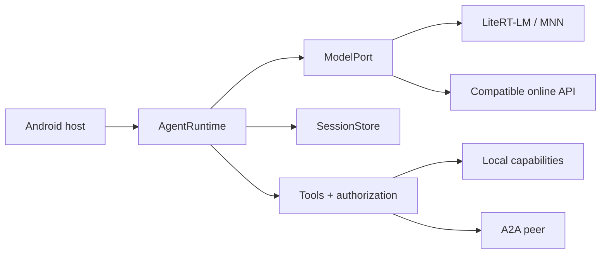

<p align="center"></p>

# Kiora

**Build Android agents that work on device and collaborate over A2A.**

Kotlin agent framework · LiteRT-LM & MNN · Local tools · Persistent sessions

**English** | [简体中文](README.zh-CN.md)

[](https://github.com/qhvssonic/kiora/actions/workflows/ci.yml)
[](LICENSE)

[Quick start](#quick-start) · [Companion app](https://github.com/qhvssonic/kiora-companion) · [Integration guide](docs/sdk-guide.en.md) · [Roadmap](#roadmap) · [Report an issue](https://github.com/qhvssonic/kiora/issues)

Kiora connects a language model to tools, authorization, and durable conversation state. Run a supported model inside your Android app, add the local capabilities your task needs, and delegate to another agent when network access is available. A2A peers can run on servers, other devices, or inside business systems.

The runtime is **pure Kotlin/JVM**. Android APIs, UI, inference engines, and heavy native dependencies are optional adapters. Online Chat Completions-compatible models can use the same agent loop.

> Experimental: APIs may change. Models and native artifacts need separate preparation; SDK snapshots currently use a local Maven publishing workflow.

## What you can build

The [Companion app](https://github.com/qhvssonic/kiora-companion) demonstrates these combinations. Product screens, permissions, indexes, and playback belong to the host app.

| Task | On the phone | With an A2A peer |
| --- | --- | --- |
| Turn paper into a usable document | Scan pages, review local OCR, ask a model to organize text, and write Markdown with approved tools | Send an approved file to an agent that implements the next step |
| Find a photo you remember | Build a local text/image embedding index and search by description | Hand selected photos to a reachable agent after approval |
| Use voice input and read replies aloud | Stream editable transcription; synthesize and play a reply locally | Delegate the reviewed text as part of a task |
| Register people and find related photos | Local face enrollment, 1:N matching, and indexed photo lookup | Face processing does not require an A2A connection |

Offline tasks require the relevant models to be prepared and a local chat backend selected. A2A and online models require a network connection. Face features are available through SDK APIs and Companion screens, not registered as chat tools by default.

## Why Kiora

- **A complete agent loop.** Tool selection, argument checks, authorization, progress, cancellation, and bounded execution sit around your model adapter.
- **Conversation state you can keep.** Branchable sessions, durable summaries, context limits, and storage interfaces support returning to previous work.
- **Local capability, remote collaboration.** Optional OCR, speech, embeddings, and face modules compose with tools discovered from A2A Agent Cards.
- **Program-owned execution boundaries.** Hosts bind file IDs, grants, recipients, and policies. Optional effect verification distinguishes observed results from unconfirmed effects.
- **Add only what you need.** The core has no Android UI dependency; platforms and model engines stay behind interfaces.

## Quick start

### Run the agent loop without a model or phone

Requires **JDK 17**. This sample uses a simulated model and A2A peer: no model weights, API key, Android SDK, or remote service is needed. The first Gradle run needs internet access to resolve build dependencies; the sample itself runs offline.

```bash
git clone https://github.com/qhvssonic/kiora.git
cd kiora
bash ./gradlew :sample:run -PskipAndroid=true
```

On Windows PowerShell, use `./gradlew.bat :sample:run -PskipAndroid=true` for the last command.

The sample prints a completed run containing the simulated peer's response. Read the [complete sample](sample/src/main/kotlin/dev/kiora/sample/Main.kt) to see the model → tool → peer → model cycle.

### Put a real model in an Android app

1. With **JDK 17 + Android SDK 35**, build `:android-demo:assembleDebug`. The demo also has a simulated offline mode.
2. Follow [local model setup](docs/on-device-models.md) for LiteRT-LM or MNN, or configure a compatible online model.
3. Add only the modules and tools you need. See [publishing snapshots and integrating a host](docs/sdk-guide.en.md#build-and-try-the-sdk).

Most detailed adapter guides are currently in Chinese; the English integration guide covers the main interfaces and build path. Companion needs additional OCR/speech artifacts; it is a separate app, not the SDK demo.

## A small runtime, explicit interfaces

```kotlin
// modelPort, appFilesDir, localTools, and toolAuthorizer are supplied by your host.
val runtime = AgentRuntime(
    model = modelPort,
    tools = localTools,
    store = JsonlSessionStore(appFilesDir.resolve("sessions")),
    authorizer = toolAuthorizer,
)

val result = runtime.run("chat-1", "Organize the selected document")
```

`ToolAuthorizer` decides whether an action may run. `ToolEffectVerifier` can observe what happened afterward. A normal API return or shell exit code of zero is not proof that an activity opened, a service started, or a business task finished.



| Area | Modules / extension points |
| --- | --- |
| Agent execution & state | `core`: `AgentRuntime`, `AgentTool`, `ModelPort`, `SessionStore` |
| Policy & result checks | `ToolAuthorizer`, `ToolArgumentPrevalidator`, `ToolEffectVerifier`, `ModelRequestPolicy` |
| Model adapters | `model-litert`, `model-mnn`, `model-chat` |
| Collaboration | `a2a`, `android-attachments` |
| Local speech & perception | `speech`, `speech-sherpa-onnx`, `document-ocr`, `document-ocr-mlkit`, `document-ocr-paddle` |
| Search & face recognition | `embedding`, `embedding-mediapipe`, `face`, `face-onnx` |
| Optional host tools | `android-storage-tools`, `android-code-sandbox`, `speech-tools`, `WorkspaceTools` |

For the full module matrix, native dependencies, and interface examples, see the [integration guide](docs/sdk-guide.en.md).

## Current status and limits

- **Local validation, 2026-11-03:** 115 SDK JVM tests and the Android demo build passed. This is a local result, not a claim that every model or device is supported.
- **Model behavior still needs work:** Gemma 4 E2B knowledge/tool-routing regression remains failing, including interpreting a request to write out a poem as a file write. Passing permission checks does not establish answer quality.
- **A2A client scope:** A2A 1.x HTTP+JSON / JSONRPC, task polling, continuation, and approved inline file uploads up to 10 MiB. Returned files, SSE, push notifications, and a full server are not implemented. Stopping a local wait does not automatically cancel a remote task.
- **Host responsibilities:** Android permissions, resource binding, source tracking, and data-egress UI are not automatic SDK guarantees. `shell` runs with the host process's permissions and is not confined to its working directory.
- **Model-dependent capabilities:** LiteRT image input is currently one image per turn; MNN native packaging is arm64-v8a. Weights are imported separately. GPU support and memory use depend on device, model, and backend.

See [runtime policy, effect verification, and device evidence](docs/runtime-safety.md) for exact validation conditions and remaining gaps. The source license does not replace model or native-library licenses.

## Roadmap

- [ ] Improve real-model tool routing and expand reproducible device regressions.
- [ ] Validate resource use and cleanup across more devices and longer sessions.
- [ ] Evaluate **Fun-ASR-Nano for dialect transcription**, starting with actual dialect samples, Android/runtime compatibility, and cancellation/memory tests. **Planned; not available today.**

[Detailed mobile roadmap](docs/mobile-agent-roadmap.md) · [Fun-ASR integration stages](docs/mobile-agent-roadmap.md#fun-asr-plan)

## Documentation and contributing

| Start here | Go deeper |
| --- | --- |
| [English integration guide](docs/sdk-guide.en.md) / [中文接入指南](docs/sdk-guide.zh-CN.md) | [Architecture](docs/architecture.md) · [Sessions](docs/session-lifecycle.md) |
| [Local models](docs/on-device-models.md) · [Model bundle](https://www.modelscope.cn/models/vqhvqh/kiora_model_bundles) | [A2A attachments](docs/attachments.md) · [Android storage](docs/android-storage-tools.md) |
| [Speech recognition](docs/speech-recognition.md) · [Speech synthesis](docs/speech-synthesis.md) | [OCR](docs/document-ocr.md) · [Embeddings](docs/embeddinggemma2-integration.md) · [Faces](docs/face-recognition.md) |

Try the sample, build a small tool, or report a device/model combination that works or fails. Useful issues include the device and Android version, model/backend, reproduction steps, and redacted logs. Documentation and English translations are welcome; see [contributing](CONTRIBUTING.md).

If Kiora is useful to your work, a star helps others discover it. For bugs and ideas, [open an issue](https://github.com/qhvssonic/kiora/issues).

Source code: [Apache-2.0](LICENSE). Model weights and third-party native artifacts retain their own terms.
