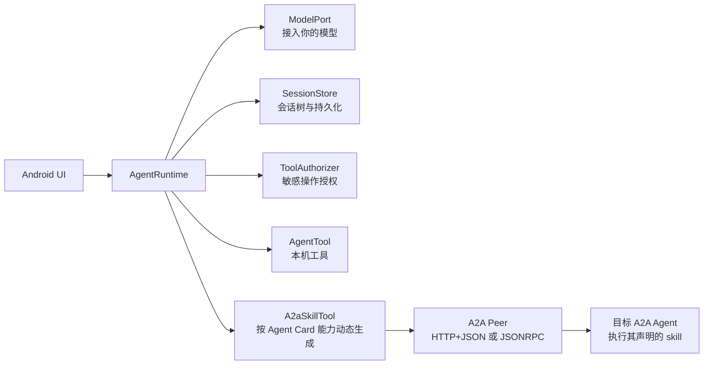

<p align="center"></p>

# Kiora

[English](README.en.md) | **简体中文**

一个面向 Android 的 Kotlin 智能体框架原型，重点提供**可直接接入智能体流程的 LiteRT-LM、MNN 端侧模型适配器**和**基于 A2A 的 Agent 协作**，同时支持兼容 Chat Completions 的在线模型。设计借鉴 pi 的小内核思路：模型、工具、会话和外部协议各守一个接口，运行循环只负责把它们串起来。`core` 是纯 Kotlin/JVM，Android 能力按模块接入；具体聊天界面和系统权限由宿主应用负责。当前版本仍处于实验阶段，API 可能调整。

许可证：[Apache-2.0](LICENSE)。



## 当前实现

设计细节见 [架构说明](docs/architecture.md)；手机文件与照片发送的接口和限制见 [A2A 附件说明](docs/attachments.md)。移动端语音、相册检索及其他差异化方向记录在 [移动端路线讨论](docs/mobile-agent-roadmap.md)。

| 模块 | 内容 |
| --- | --- |
| `core` | 有界模型/工具循环、取消传播、工具选择与授权、JSON Schema 参数基础校验、宿主结构化工具结果与输出 Schema 校验、等待用户输入/授权状态、上下文窗口裁剪与持久摘要、模型用量记录、运行中指令队列、图片消息与工具结果、事件、分支会话、内存和 JSONL 存储；另提供可选的 `WorkspaceTools` |
| `a2a` | 向其他 Agent 委托任务；从 Agent Card 读取每项 skill 及输入 MIME 类型并生成模型工具；A2A 1.x HTTP+JSON 与 JSONRPC 的发现、发送、续接、轮询、取消、文本、内联文件及 JSON 数据发送，支持 Bearer 凭据和跨任务的 `contextId` |
| `android-attachments` | 将系统选择器授权的 `content://` 文件或照片安全地读成有大小上限的 A2A 附件 |
| `android-storage-tools` | 基于 Android SAF 持久授权的目录与单张照片工具：浏览、搜索、查看信息、读取文本、复制、移动、重命名、删除；宿主提供授权 URI 清单 |
| `android-code-sandbox` | 在 Android 独立进程中执行受限 JavaScript；可选安装 |
| `model-chat` | Chat Completions 兼容端点的多提供商配置、文本与函数工具、图片工具结果、SSE 增量输出 |
| `model-litert` | Android 端直接运行 `.litertlm` 模型，可选择 CPU/GPU 后端，支持流式文本、可选单图视觉输入与手动工具调用；GPU 可用性取决于设备和模型 |
| `model-mnn` | Android 进程内运行 MNN 3.6.1 模型目录，支持文本、视觉模型图片输入、流式输出、取消和经 Kiora 授权的工具循环；当前仅打包 arm64-v8a |
| `embedding` | 独立于聊天模型的纯 Kotlin 嵌入接口与向量比较；检查模型身份及维度，并支持截取后重新归一化 |
| `face` | 纯 Kotlin 人脸接口、质量状态、多样本注册、模型隔离与 1:N 匹配；宿主注入持久化 |
| `face-onnx` | 可选 Android InsightFace buffalo_sc 适配器：SCRFD 检测、五点对齐和 MobileFaceNet 特征；宿主提供统一 ONNX Runtime，权重独立导入 |
| `embedding-mediapipe` | 可选 Android EmbeddingGemma 2 适配器，通过 MediaPipe Universal Embedder 从应用私有目录加载 `.litertlm`，生成文字和图片的向量；模型权重需另行导入 |
| `speech` | 纯 Kotlin 的短音频转写、流式识别事件与离线合成契约；PCM、文本长度和取消语义均与 Android UI 解耦 |
| `speech-sherpa-onnx` | 可选 Android 端 SenseVoice Small int8、流式 Paraformer 中英双语 int8 识别与 MeloTTS FP32/int8 合成适配器，需另备 sherpa-onnx AAR 与各自模型文件 |
| `speech-tools` | 可选的 `speak_text` 智能体工具；由宿主注入合成加播放实现，复用参数校验和工具授权 |
| `document-ocr` | 纯 Kotlin 的单页 OCR 契约，返回原文、逐行文字和位置 |
| `document-ocr-mlkit` | 可选 Android 端 ML Kit 中文打包模型适配器，支持离线识别与 EXIF 方向处理 |
| `document-ocr-paddle` | 可选 PP-OCRv6 Android 适配器，依赖单独准备的官方 AAR 与 ONNX 模型；默认构建不包含 |
| `android-demo` | Android 聊天界面、离线模拟模式、模型与 A2A 配置、工具授权弹窗、会话恢复 |
| `sample` | 不依赖网络的 JVM 命令行演示：智能体将任务委托给模拟电脑端 |

离线 TTS 复用 sherpa-onnx 1.13.8 和 MeloTTS 中英模型，目标手机实测后推荐 FP32，同时保留 int8 导入。Companion 由用户点击回复扬声器图标启动或停止朗读，不注册 `speak_text`；SDK 的 `speech-tools` 仍供其他宿主按需接入。模型需单独准备和导入；SDK 不提供播放 UI。模型资产、播放实现与真机记录见 [离线语音合成](docs/speech-synthesis.md)。支持方言的 Fun-ASR-Nano 已列为后续识别候选，尚未接入。

本地人脸由 `face` 提供注册、存储契约和 1:N 匹配，由 `face-onnx` 提供检测、对齐和特征提取。
Companion 0.1.103 在宿主层实现人员管理、实时扫描自动查询和相册增量索引；预览帧不落盘，
人员特征保存在应用私有数据库。模型准备、SDK 用法和验证边界见 [人脸接入](docs/face-recognition.md)。

`ModelPort` 可由宿主应用自行实现；`model-chat` 提供 Chat Completions 兼容适配器。A2A 客户端支持文本和总计 10 MiB 以内的内联文件发送，以及同步请求/轮询；目前不包含 A2A SSE、远端文件下载、推送通知或完整 A2A 服务端。目标 Agent 需要提供手机可访问、符合 A2A 1.x HTTP+JSON 或 JSONRPC 的服务，普通 CLI 入口不能直接当作 A2A 服务。

A2A 对端不限于电脑，也可以是服务器、其他设备或业务系统中的 Agent。当前返回 Part 只提取文本，远端 JSON 数据和文件尚未保留为可用产物；停止本地等待不会自动取消远端任务。

首次委托可不传 `contextId`，由远端在 Task 中返回；宿主按本地会话和远端连接保存该值，下一次新任务通过 `A2aUserMessage.contextId` 传回。`taskId` 仅用于继续同一个未完成任务，不能替代跨任务的会话上下文。

EmbeddingGemma 2 的 SDK 用法与 Android 依赖边界见 [嵌入模型接入说明](docs/embeddinggemma2-integration.md)。嵌入适配器不属于 `AgentRuntime` 的聊天模型；Companion 将它用于手机相册本地向量检索。宿主引入 MediaPipe 时仍须核对 LiteRT-LM 依赖版本与目标设备兼容性。

典型的纸质文档流程由 SDK 能力和宿主应用共同组成：`document-ocr` 契约及可选的 `document-ocr-paddle` 适配器逐页识别，`WorkspaceTools` 可供智能体写入 Markdown，`a2a` 可通过宿主核验的文件 ID 上传工作区文件。[Kiora Companion](https://github.com/qhvssonic/kiora-companion) 实现多页扫描、人工校对、工具授权和工作区文件选择；电脑端处理由另行部署的 A2A Agent 执行。此流程展示 SDK 能力如何组合，扫描和产品界面不属于 SDK 内核。

### 工具与 Android 权限

`WorkspaceTools(directory).all()` 提供一组可选的基础工具。SDK 不会自动把它们加入每个智能体；宿主应按场景选择并通过 `ActiveToolSelector` 控制本轮可见工具。

| 工具 | 行为与边界 |
| --- | --- |
| `read` | 读取工作区内相对路径的 UTF-8 文本，文件上限 1 MiB，返回内容上限 32 KiB |
| `write` | 创建或覆盖工作区内的 UTF-8 文件，内容上限 1 MiB |
| `edit` | 将工作区文件中唯一匹配的原文精确替换 |
| `shell` | 从工作区启动命令，但命令以宿主进程的身份执行（在 Android 应用中即该应用的 UID），**不受工作区路径限制**；命令、输出和运行时间有上限 |

`read`、`write`、`edit` 只处理配置的工作区，不能直接读取手机相册或其他应用文件。`shell` 则能使用宿主进程已有的系统权限，不能当作受限工作区工具。`android-storage-tools` 单独提供基于 SAF 授权的文件操作，其 `list_authorized_photos` 只列出逐张持久授权的照片，不代表浏览整个相册。若宿主想浏览整个相册，需要先获得 Android 的完整照片访问权限，并自行通过 MediaStore 提供相应工具；`kiora-companion` 就采用这种集成方式。`android-code-sandbox` 的 JavaScript 独立进程工具与 `shell` 是两种不同能力，也不会自动互相替代。宿主负责工具选择、用户授权和 Android 系统权限。

`content://` URI 转文件字节属于宿主内部的数据准备步骤，不是默认模型工具。模型需要查看用户选中的内容时，宿主可以把有时效的文件 ID 接入 `read`；模型决定发送文件时，由相应的 A2A skill 工具在授权后调用宿主文件读取器。`android-attachments` 提供有 10 MiB 上限的 Android URI 读取辅助类，也可以由宿主自行实现；`a2a` 负责将已有字节编码并发送。

### 图片与上下文

用户直接选择或拍摄的图片可作为 `AgentRuntime.run(sessionId, userText, images)` 的图片输入。工具读取图片时，可通过 `AgentTool.executeResult()` 返回含 `ToolImage` 的 `ToolOutput`，把图像本体交给当前视觉模型；普通 `execute()` 仍只返回文本。`model-chat` 将图片编码进兼容接口消息；LiteRT-LM 需启用视觉输入，当前一次处理一张图片。实际能否识别，还取决于所用模型及其接口是否支持图像。

宿主可按**实际模型**设置 `contextWindowTokens`，并配置 `reserveOutputTokens`、`extraInputTokens`。运行时估算工具定义、文本、图片与输出预留量，保留当前用户轮次，尽量附带最近的完整历史轮次；过长的工具文本结果可仅在模型请求中截断。完整会话仍保留在存储中。若模型报告上下文超限，运行时会缩小窗口重试一次。这是估算与错误恢复机制，并非模型 tokenizer 的精确计数；未设置窗口时不会自动裁剪历史。

长会话可由宿主调用 `AgentRuntime.compact()` 生成分支感知的持久摘要；兼容端点报告的 token 用量可作为会话元数据保存。运行中还可排入 steering 和 follow-up 指令。具体时机、存储要求与恢复语义见 [会话生命周期](docs/session-lifecycle.md)。

宿主也可传入 `AutoCompaction`，按自己的设备资源预算在模型请求前自动调用持久摘要。摘要失败时仍沿用已配置的上下文窗口裁剪保护；自动摘要不会删除原始会话消息。

本地人脸注册、1:N 检索与相册演示的接入、模型许可和验证边界见 [人脸功能](docs/face-recognition.md)。此能力不自动加入智能体工具，也不上传照片或特征。

## 后续计划：Fun-ASR 方言语音识别

**状态：已列入集成计划，尚未实现；当前语音识别支持 SenseVoice 和流式 Paraformer；Fun-ASR-Nano 尚未实现。** Fun-ASR 用于语音转文字，离线朗读继续使用 MeloTTS。

- [ ] 以 Fun-ASR-Nano 为候选，固定模型版本，核对 Android 导出包、配套文件和运行库兼容性。
- [ ] 优先复用现有 sherpa-onnx，为 `SpeechRecognitionPort` 增加按需启用的识别适配器；处理加载、取消、释放与错误状态。
- [ ] 在真机验证模型准备后的离线转写、峰值内存，以及与聊天模型和 TTS 交替使用时的资源释放。
- [ ] 收集目标方言样本，与 SenseVoice 对比转写错误率、数字/地名识别和延迟，再决定正式开放范围。

具体方言尚未确定，不预先承诺覆盖或准确率。完整阶段、验收条件及 Companion 分工见 [Fun-ASR 集成计划](docs/mobile-agent-roadmap.md#fun-asr-plan)。

## 运行

需要 JDK 17。默认构建还需要 Android SDK（`compileSdk 35`），通过 `local.properties` 中的 `sdk.dir` 或 Android SDK 环境变量配置。项目自带 Gradle Wrapper：

```powershell
.\gradlew.bat test
.\gradlew.bat :sample:run
.\gradlew.bat :android-demo:assembleDebug
```

只验证纯 Kotlin/JVM 模块时，可加 `-PskipAndroid=true`；此时不会包含 Android 模块。上面的默认构建不包含 `speech-sherpa-onnx` 和 `document-ocr-paddle`，它们分别需要本地 AAR 仓库及 `-PsherpaLocalRepo=...`、`-PpaddleLocalRepo=...`。准备步骤见下方的语音与 OCR 文档。

将基础 SDK 模块发布到本机 Maven 缓存，供另一个 Android 项目在本机引用：

```powershell
.\gradlew.bat :core:publishToMavenLocal :a2a:publishToMavenLocal :model-chat:publishToMavenLocal :model-mnn:publishToMavenLocal :model-litert:publishToMavenLocal :android-attachments:publishToMavenLocal :android-storage-tools:publishToMavenLocal :android-code-sandbox:publishToMavenLocal
.\gradlew.bat :document-ocr:publishToMavenLocal :document-ocr-mlkit:publishToMavenLocal :speech:publishToMavenLocal :speech-tools:publishToMavenLocal
.\gradlew.bat :embedding:publishToMavenLocal :embedding-mediapipe:publishToMavenLocal
```

在宿主项目的仓库列表中加入 `mavenLocal()`，然后按需引用 `dev.kiora:kiora-core:0.3.0-SNAPSHOT`、`dev.kiora:kiora-a2a:0.3.0-SNAPSHOT`、`dev.kiora:kiora-model-chat:0.3.0-SNAPSHOT`、`dev.kiora:kiora-model-litert:0.3.0-SNAPSHOT`、`dev.kiora:kiora-model-mnn:0.3.0-SNAPSHOT`、`dev.kiora:kiora-embedding:0.3.0-SNAPSHOT`、`dev.kiora:kiora-embedding-mediapipe:0.3.0-SNAPSHOT`、`dev.kiora:kiora-android-attachments:0.3.0-SNAPSHOT`、`dev.kiora:kiora-android-storage-tools:0.3.0-SNAPSHOT`、`dev.kiora:kiora-android-code-sandbox:0.3.0-SNAPSHOT`、`dev.kiora:kiora-document-ocr:0.3.0-SNAPSHOT`、`dev.kiora:kiora-document-ocr-mlkit:0.3.0-SNAPSHOT`、`dev.kiora:kiora-speech:0.3.0-SNAPSHOT`、`dev.kiora:kiora-speech-tools:0.3.0-SNAPSHOT`。A2A 和模型模块会传递依赖 `core`。`mavenLocal()` 适合本机开发；另一台电脑或 CI 构建宿主应用前，也需要先发布这些 SDK 模块。端侧模型用法见 [端侧模型说明](docs/on-device-models.md)；EmbeddingGemma 2 的模型准备与兼容性见 [嵌入模型接入说明](docs/embeddinggemma2-integration.md)；授权目录工具见 [Android 存储工具](docs/android-storage-tools.md)；语音模块的可选依赖与模型准备见 [端侧语音识别](docs/speech-recognition.md)和[离线语音合成](docs/speech-synthesis.md)；OCR 的边界、基线对照和可选 Paddle 构建步骤见 [端侧文档 OCR](docs/document-ocr.md)。

Android Studio 打开 `kiora` 目录，选择 `android-demo` 运行。构建后的 APK 位于 `android-demo/build/outputs/apk/debug/android-demo-debug.apk`。这里的 Demo 用于验证 SDK 链路；独立产品应用 `kiora-companion` 在本地开发时位于同级目录 `../kiora-companion`，其设置、相册浏览、拍照和实时 Markdown 排版属于宿主实现，并非 SDK 自动提供。

### Demo 的两种使用方式

1. **离线试用**：保持“离线模拟模型”勾选，直接发送“查看设备信息”。授权弹窗通过后会显示设备信息。这一路径无需模型密钥。
2. **真实模型**：取消离线模式，填入模型站点地址（如 `https://example.com`）、模型 ID 和可选 API Key，点击“应用配置并连接”，再发送消息。站点根地址会自动补上 `/v1/chat/completions`；已有完整 Chat Completions 地址保持原样。兼容端点支持 SSE 时，回答会逐字显示；不支持流式的服务可在宿主 SDK 配置 `supportsStreaming = false`。工具调用取决于所用模型服务是否支持相应格式。

Demo 的“启用独立进程 JavaScript 工具”默认关闭。勾选并重新连接后，模型可请求受限代码计算，每次仍会弹出授权确认；设备的 JavaScriptEngine 不可用时会返回工具错误。

要让手机委托电脑端，填写电脑端的 **Agent Card URL** 和可选 Bearer Token。连接状态会列出 Agent Card 中发现的能力，例如“企业知识库检索、企业业务数据查询”。真实模型收到这些能力的名称、描述和示例后，可以按用户问题选择对应工具；授权后 Demo 通过 A2A 发送并轮询结果。例如询问“原始凭证分类的规范是怎么定义的”应选择知识库能力，询问“各部门的人数分布”应选择业务数据能力。A2A skill 是能力说明，不是单独的远程 RPC 方法；调用仍使用 A2A 消息。模型是否发起工具调用也取决于所用模型服务的工具调用能力。若 Agent Card 没有列出技能，Demo 仍提供通用电脑端委托工具。离线模拟模型支持“请电脑处理这个任务”这条真实 A2A 链路。Demo 会从 Agent Card 选择 A2A 1.x 的 HTTP+JSON 或 JSONRPC 接口。如果卡片把接口主机写成 `localhost`，Demo 会临时使用 Agent Card URL 的主机替代；正式部署时应由电脑端在卡片中公布手机可访问的地址。模拟器访问宿主电脑的本地服务通常使用 `10.0.2.2`。Debug APK 允许局域网明文 HTTP，Release 配置要求 HTTPS。**Demo** 的模型密钥和 A2A Token 只保留在当前应用进程内；`kiora-companion` 使用 Android Keystore 加密后持久保存，行为见其 README。

在自己的 Android 宿主中：

1. 使用 `ChatCompletionModelPort`、`LiteRtModelPort`、`MnnModelPort`，或实现 `ModelPort` 连接其他模型 API。需要增量文本时实现或调用 `respondStreaming()`。
2. 选择 `WorkspaceTools` 或为真实工具实现 `AgentTool`。用 `ActiveToolSelector` 按会话选择本轮可用的工具，再用 `ToolAuthorizer` 接入 Android 的确认界面；授权请求带有 `sessionId`、工具定义和已校验的调用，可由宿主决定自动允许或弹窗。未启用的工具不能执行。文件访问范围由工具实现和 Android 系统权限约束。
3. 将 `SessionStore` 绑定到应用私有目录；`JsonlSessionStore` 可作初始方案，规模扩大后可换成 Room。存储 I/O 在后台调度器执行。
4. 从电脑端的 Agent Card URL 使用 `A2aPeerConnector.discoverConnection()` 创建连接，再把 `connection.skillTools()` 放进工具列表；卡片没有技能时可使用 `A2aDelegateTool(connection.peer)`。应用需要 `INTERNET` 权限；若使用局域网 HTTP，Android 的明文流量策略也需按目标域名配置。

```kotlin
val connection = A2aPeerConnector.discoverConnection(
    agentCardUrl = "https://desktop.example/.well-known/agent-card.json",
    bearerToken = { tokenRepository.currentToken() },
)
val remoteTools: List<AgentTool> = if (connection.skills.isEmpty()) {
    listOf(A2aDelegateTool(connection.peer))
} else {
    connection.skillTools()
}
val runtime = AgentRuntime(
    model = myModelPort,
    tools = remoteTools + myLocalTool,
    store = JsonlSessionStore(filesDir.resolve("sessions")),
    authorizer = myToolAuthorizer,
)
val result = runtime.run(sessionId = "chat_1", userText = "请电脑端整理这份报告")
```

`A2aDelegateTool` 在电脑端要求补充信息时，将任务 ID 和问题返回给模型；下一次调用带上 `taskId` 即可继续同一任务。远端要求授权时也会返回任务 ID 和说明，由宿主应用处理授权流程。

Agent Card 中每项 skill 都生成自己的模型工具。SDK 优先使用该 skill 的 `inputModes`，缺省时使用 Agent Card 的 `defaultInputModes`。有效输入模式声明 `application/json` 时，该工具提供可选 `form` 对象并发送 A2A `data` Part；声明文件 MIME 类型（如 `application/pdf` 或 `image/*`）且宿主向 `skillTools(fileLoader = …)` 提供文件读取回调时，工具才提供 `files` 参数并发送 `raw` Part。文件 ID 由宿主分配和核验，不接受模型提交任意 Android URI。A2A 标准的 Agent Card 并不定义通用表单字段 Schema；目标 Agent 需要在 skill 描述中说明字段，或与宿主约定额外的 Schema。只声明文本输入的 skill 不会获得文件上传参数。具体流程见 [A2A 附件说明](docs/attachments.md)。

多提供商切换、增量事件和代码沙箱的 SDK 接入示例见 [模型与沙箱说明](docs/models-streaming-sandbox.md)。

需要发送用户选择的文件或照片时，可在 Android 宿主读取获授权的内容 URI，然后调用 `connection.peer.send(A2aUserMessage("请处理附件", listOf(A2aInlineFile("photo.jpg", "image/jpeg", bytes))))`。此接口使用 A2A 1.0 `raw` Part；目标 Agent 也必须支持附件输入。

## 设计约束

- 一个会话的多次 `run()` 串行执行，不同会话可并行。
- 每次运行有模型轮数、工具调用次数、总时长限制；协程取消会继续向外传播。
- 每轮先由 `ActiveToolSelector` 选择模型可见的工具；工具调用再经过参数校验和 `ToolAuthorizer` 授权。授权回调只接收本轮已选且参数有效的调用，`ToolAuthorizationRequest.sessionId` 可用于会话级策略。未启用的工具不能执行。
- 工具参数在授权前限制为默认最多 16 KiB，并按 JSON Schema 的常用类型、必填字段、数组项及枚举进行基础校验；语义约束仍由工具自身检查。格式错误会作为工具结果交给模型，供其修正。
- 工具错误的 `failureKind` 为宿主提供结构化原因；模型输出因长度上限截断时，`model-chat` 不执行其中的工具调用。详情见 [模型与沙箱说明](docs/models-streaming-sandbox.md)。
- 长任务可通过可选的 `ProgressReportingAgentTool` 发送临时进度事件；SDK 的默认 A2A 工具会上报远端状态变化，进度不会写入会话。
- `WorkspaceTools` 提供 `read`、`write`、`edit`、`shell` 四个工作区工具；宿主需要显式加入并配置权限。`shell` 以宿主进程权限运行，工作区只是初始目录。
- 工具默认仍返回文本；需要让当前视觉模型直接查看图片时，实现 `AgentTool.executeResult()` 并返回包含 `ToolImage` 的 `ToolOutput`。运行时会把图片放进工具结果，会话存储保留图片内容，模型适配器负责转换成各模型接口接受的图片消息。
- 用户直接选择的照片可通过带 `images` 参数的 `run()` 传入运行时；Chat Completions 适配器将其编码为用户消息中的图片块，本机 LiteRT-LM 在开启视觉输入后读取同一图片内容。
- 会话采用追加记录及活动叶节点，切换分支不删除旧记录。
- `JsonlSessionStore` 是单进程实现；多进程访问需要额外的文件锁或数据库。

协议对照：[A2A 1.0 官方规范](https://a2a-protocol.org/latest/specification/)。
模型适配器对照：[OpenAI Docs 的 Chat Completions 工具调用格式](https://developers.openai.com/api/reference/resources/chat/subresources/completions/methods/create)。
