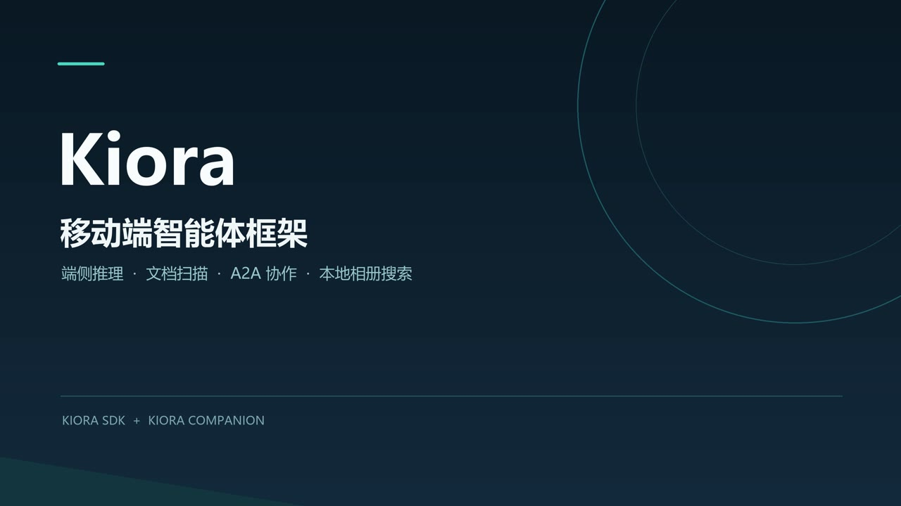
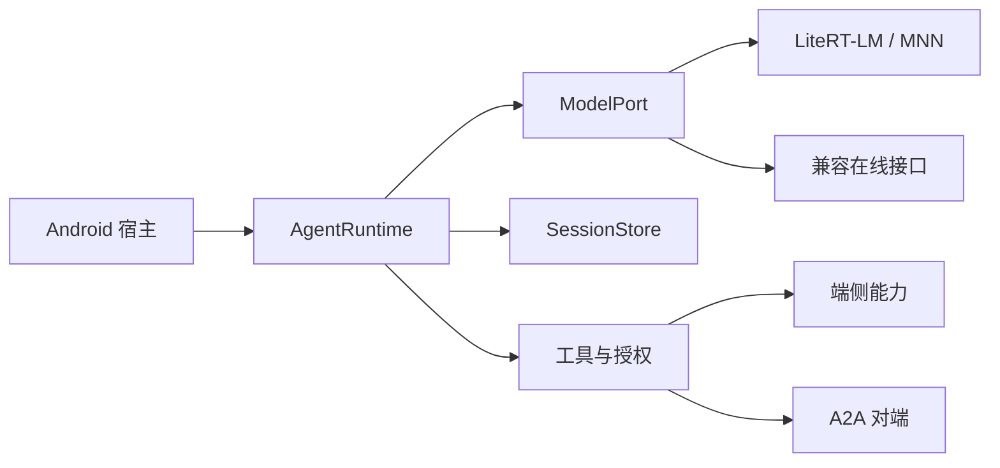

<p align="center"></p>

# Kiora

**让 Android 智能体在本机处理任务，并通过 A2A 与其他智能体协作。**

Kotlin 智能体框架 · LiteRT-LM / MNN · 本地工具 · 持久会话

[English](README.md) | **简体中文**

[](https://github.com/qhvssonic/kiora/actions/workflows/ci.yml)
[](LICENSE)

[演示视频](#演示视频) · [快速开始](#快速开始) · [Companion 应用](https://github.com/qhvssonic/kiora-companion) · [完整接入指南](docs/sdk-guide.zh-CN.md) · [路线图](#路线图) · [反馈问题](https://github.com/qhvssonic/kiora/issues)

Kiora 把模型、工具、授权和会话状态接入同一条运行链路：在 Android 应用内运行端侧模型，组合完成任务所需的本地能力，联网后再把适合的工作委托给其他 Agent。A2A 对端可以是服务器、其他设备或业务系统中的智能体。

**核心是纯 Kotlin/JVM**，Android UI、平台 API、推理引擎和重型原生依赖通过可选适配器接入；兼容 Chat Completions 的在线模型也能使用同一套智能体流程。

> 当前处于实验阶段，API 可能调整。模型与部分原生库需单独准备，SDK 快照目前通过本机 Maven 发布流程接入。

## 演示视频

[](https://github.com/qhvssonic/kiora-companion/releases/download/v0.1.108/kiora-demo-zh-subtitles.mp4)

**[▶ 观看／下载字幕版演示](https://github.com/qhvssonic/kiora-companion/releases/download/v0.1.108/kiora-demo-zh-subtitles.mp4)** · 3 分 28 秒 · 中文字幕 · 4K MP4，约 203 MiB

通过 [Companion](https://github.com/qhvssonic/kiora-companion) 展示 SDK 的端侧推理、扫描整理 Markdown、A2A 文件交付与相册语义搜索。视频于 **2026-10-22** 录制，展示较早版本，当前界面与能力已有更新。原片作为 Release 附件保存，点击封面或链接打开／下载。

## 可以做什么

[Companion](https://github.com/qhvssonic/kiora-companion) 展示了以下能力组合。产品界面、权限、索引和播放流程由宿主应用实现。

| 具体任务 | 在手机上完成 | 通过 A2A 扩展 |
| --- | --- | --- |
| 把纸质资料整理成可用文档 | 多页扫描、本地 OCR、人工校对，再让模型组织文字并调用已授权工具写入 Markdown | 经批准发送文件，交给实现了后续能力的 Agent |
| 找到记忆中的照片 | 建立本地文字/图片向量索引，按描述搜索 | 经批准将选中的照片交给可访问的 Agent |
| 用语音输入、听取回复 | 实时转写后编辑确认，本机合成与播放回复 | 将确认后的文字用于委托任务 |
| 注册人员并查找相关照片 | 本地人脸注册、1:N 匹配和相册索引查询 | 人脸处理本身无需连接远端 |

离线任务要求相关模型已准备完成，并选择本机聊天后端；A2A 和在线模型需要网络。人脸能力通过 SDK API 和 Companion 页面使用，默认不注册为聊天工具。

## 为什么使用 Kiora

- **完整的智能体运行循环**：模型之外还有工具选择、参数校验、授权、进度、取消和执行上限。
- **能够持续使用的会话**：分支、持久摘要、上下文限制和存储接口支持恢复先前工作。
- **本地能力与远端协作组合**：OCR、语音、向量和人脸模块按需接入，A2A 工具从 Agent Card 发现。
- **程序负责执行边界**：宿主绑定文件 ID、权限、接收方和资料策略；可选效果验证区分已观察结果与未确认效果。
- **按需引入依赖**：核心不依赖 Android UI，平台和模型引擎留在适配层。

## 快速开始

### 不准备模型和手机，先运行智能体循环

需要 **JDK 17**。示例使用模拟模型和模拟 A2A 对端，无需模型权重、API Key、Android SDK 或远端服务。首次 Gradle 构建需要联网获取依赖，示例运行本身不联网。

```bash
git clone https://github.com/qhvssonic/kiora.git
cd kiora
bash ./gradlew :sample:run -PskipAndroid=true
```

Windows PowerShell 的最后一条命令改为 `./gradlew.bat :sample:run -PskipAndroid=true`。

终端会输出包含模拟对端结果的已完成运行。查看[完整示例](sample/src/main/kotlin/dev/kiora/sample/Main.kt)，了解模型 → 工具 → 对端 → 模型的流程。

### 在 Android 应用中接入真实模型

1. 准备 **JDK 17 和 Android SDK 35**，构建 `:android-demo:assembleDebug`；Demo 也提供离线模拟模式。
2. 按[端侧模型说明](docs/on-device-models.md)准备 LiteRT-LM 或 MNN 模型，或配置兼容在线接口。
3. 只接入任务需要的模块与工具，按[完整指南](docs/sdk-guide.zh-CN.md#运行)发布本机 Maven 快照并集成宿主。

Companion 是独立应用，需要额外准备 OCR 和语音原生依赖，不等同于 SDK Demo。

## 小内核，明确的接口

```kotlin
// modelPort、appFilesDir、localTools 和 toolAuthorizer 由宿主提供。
val runtime = AgentRuntime(
    model = modelPort,
    tools = localTools,
    store = JsonlSessionStore(appFilesDir.resolve("sessions")),
    authorizer = toolAuthorizer,
)

val result = runtime.run("chat-1", "整理选中的文档")
```

`ToolAuthorizer` 决定动作能否执行，`ToolEffectVerifier` 可以观察执行后的效果。API 正常返回或 shell 退出码为 0，都不能单独证明页面已打开、服务已启动或业务任务已完成。



| 方向 | 模块与扩展点 |
| --- | --- |
| 智能体执行与状态 | `core`：`AgentRuntime`、`AgentTool`、`ModelPort`、`SessionStore` |
| 策略与结果检查 | `ToolAuthorizer`、`ToolArgumentPrevalidator`、`ToolEffectVerifier`、`ModelRequestPolicy` |
| 模型适配 | `model-litert`、`model-mnn`、`model-chat` |
| 协作 | `a2a`、`android-attachments` |
| 本地语音与感知 | `speech`、`speech-sherpa-onnx`、`document-ocr`、`document-ocr-mlkit`、`document-ocr-paddle` |
| 检索与人脸 | `embedding`、`embedding-mediapipe`、`face`、`face-onnx` |
| 可选宿主工具 | `android-storage-tools`、`android-code-sandbox`、`speech-tools`、`WorkspaceTools` |

完整模块表、原生依赖和接入示例见[接入指南](docs/sdk-guide.zh-CN.md)。

## 当前状态与限制

- **2026-11-03 本地验证**：SDK 115 项 JVM 测试及 Android Demo 构建通过，不代表所有模型和设备均已适配。
- **模型行为仍需完善**：Gemma 4 E2B 的知识与工具选择回归仍未通过，存在把“写出诗句”理解成写文件的情况。权限保护通过不等于回答质量通过。
- **A2A 客户端范围**：支持 A2A 1.x HTTP+JSON / JSONRPC、轮询、续接和经批准的合计 10 MiB 以内内联文件上传。尚无远端文件接收、SSE、推送通知或完整服务端；停止本地等待不会自动取消远端任务。
- **宿主责任**：Android 权限、资源绑定、来源跟踪和资料外发界面需要宿主接入。`shell` 使用宿主进程权限，工作区只是初始目录。
- **模型与设备边界**：LiteRT 当前每轮单图，MNN 原生库当前仅 arm64-v8a；权重独立导入。GPU 支持和内存占用取决于设备、模型与后端。

完整验证条件及剩余缺口见[运行策略、效果验证与真机记录](docs/runtime-safety.md)。代码许可不替代模型和原生库的许可。

## 路线图

- [ ] 改进真实模型的工具选择，补充可复现的真机回归。
- [ ] 扩大多设备、长会话下的资源占用与清理验证。
- [ ] 验证 **Fun-ASR-Nano 方言转写**：从真实方言样本、Android/运行库兼容性、取消及内存测试开始。**已列入计划，当前尚未接入。**

[完整移动端路线图](docs/mobile-agent-roadmap.md) · [Fun-ASR 集成阶段](docs/mobile-agent-roadmap.md#fun-asr-plan)

## 文档与参与贡献

| 从这里开始 | 深入了解 |
| --- | --- |
| [中文接入指南](docs/sdk-guide.zh-CN.md) / [English integration guide](docs/sdk-guide.en.md) | [架构](docs/architecture.md) · [会话生命周期](docs/session-lifecycle.md) |
| [端侧模型](docs/on-device-models.md) · [ModelScope 模型合集](https://www.modelscope.cn/models/vqhvqh/kiora_model_bundles) | [A2A 附件](docs/attachments.md) · [Android 存储](docs/android-storage-tools.md) |
| [语音识别](docs/speech-recognition.md) · [语音合成](docs/speech-synthesis.md) | [OCR](docs/document-ocr.md) · [向量](docs/embeddinggemma2-integration.md) · [人脸](docs/face-recognition.md) |

欢迎运行示例、接入一个小工具，或反馈某个设备/模型组合的成功与失败。Issue 请包含设备、Android 版本、模型/后端、复现步骤和脱敏日志。也欢迎改进文档与英文翻译，见[贡献指南](CONTRIBUTING.md)。

如果 Kiora 对你有帮助，欢迎 Star，让更多开发者发现它。问题与建议请[提交 Issue](https://github.com/qhvssonic/kiora/issues)。

代码采用 [Apache-2.0](LICENSE)；模型权重和第三方原生库遵循各自许可。
