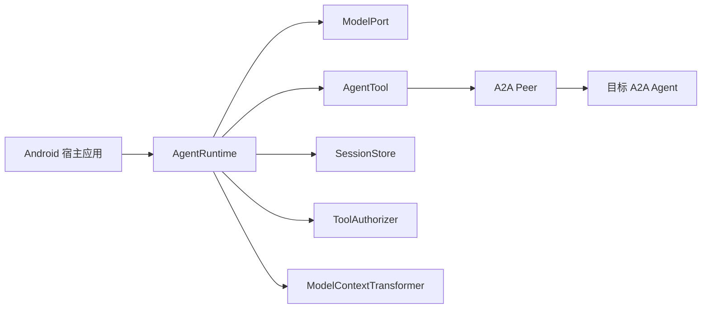

# Kiora 架构

独立人脸能力由 `face`（纯 Kotlin 的注册、特征、匹配及宿主存储接口）和 `face-onnx`（可选 Android 推理）提供。
相机、相册权限、媒体 ID 和照片索引属于宿主；不修改聊天内核，不自动注册人脸工具。
模型准备、数据边界和验证条件见 [人脸接入](face-recognition.md)。

Kiora 将手机端智能体拆成五个可替换的边界：

一次运行的顺序是：写入用户消息 → 投影当前分支的摘要与原始消息 → 转换模型上下文 → 请求模型 → 授权并执行工具 → 写入工具结果 → 再次请求模型。原始消息追加到会话树；`ModelContextTransformer` 只改变发给模型的视图，不删除原始记录。模型可以使用多个工具，但每次运行受轮数、调用次数和总时间限制。用量、摘要与排队指令作为独立元数据持久化。

LiteRT 默认指令区分普通知识问答、聊天文本输出和实际资源操作：工具可用不代表必须调用；读取目标应来自用户、宿主或成功工具结果，不能把话题名称编成文件路径；只有用户要求保存或修改文件时才写文件。Companion 的 `read` 描述也声明此边界。这里是模型决策指引，不能替代代码中的路径范围、资源 ID、存在性和权限校验，也不能保证小模型的知识回答正确。真实模型回归需分别验证“不误调用工具”和“回答内容正确”，不能只根据前者宣布问题已解决。

2026-10-26 的 V2509A / Gemma 4 E2B 真机回归未通过：在 Companion 0.1.99 配套规则下，不提供工具时仍把“锄禾”误认为歌曲；有工具的独立问答没有调用工具但内容错误，古诗上下文追问仍调用 `read`，要求写出诗句仍调用 `write`。普通乘法与明确附件 `selected:0` 的读取选择通过。`LocalToolRoutingTest` 为显式开启的设备测试，只检查模型输出，不实际执行工具，不写入用户会话；应先打开主应用再启动 instrumentation，避免部分 OEM 禁止后台启动测试设置页。这些结果说明提示词调整尚未解决工具误用，不能据此宣称模型理解、知识准确性或完整 Agent 链路已通过验收。

宿主已知模型实际上下文窗口时，可向 `AgentRuntime` 传入 `contextWindowTokens`。运行时按消息文本、工具定义和额外模态开销估算输入，预留回复空间，优先保留最近完整轮次；单轮工具结果过长时仅截断模型视图，会话树仍保存完整结果。模型若报告上下文超限，运行时根据报出的上限缩小窗口并重试一次。未知窗口不做猜测，由宿主提供模型目录值或用户配置；估算是保守回退，不能替代模型原生 token 用量。

## 与 pi 的对应关系

| pi 中的设计 | Kiora 当前实现 | 移动端取舍 |
| --- | --- | --- |
| 小型 agent loop | `core/AgentRuntime` | 不绑定 Android 生命周期；宿主负责启动和取消协程 |
| 模型适配层 | `ModelPort`、`model-chat` | 可换云端或本地模型 |
| 工具与调用事件 | `AgentTool`、`AgentEvent` | 本轮工具选择、参数校验和 `ToolAuthorizer` 授权；工具错误有结构化分类，文本与可选工具进度以事件上报 |
| 分支会话 | `SessionTree`、`SessionStore` | JSONL 是原型实现，大规模数据可换 Room；摘要和排队指令跟随分支 |
| 上下文转换 | `ModelContextTransformer`、`SessionSummarizer` | 可按设备内存和模型上下文窗口裁剪或持久压缩历史 |
| 外部能力 | `a2a` 模块 | 从 Agent Card 发现能力，并以 A2A 消息执行 |

Kiora 不把 pi 的终端工具、文件系统权限或 CLI 默认行为直接搬到手机。Android 宿主应通过系统文件选择器获得用户明确授予的文件 URI，通过 `ContentResolver` 读取，并在传输前显示目标和文件信息。

### 值得继续借鉴的能力

以下按 SDK 对移动端的实际收益排序；`kiora-companion` 是 SDK 宿主，可在 SDK 接口成熟后再接入界面。

| 优先级 | pi 的实现 | Kiora 现状与建议 |
| --- | --- | --- |
| 已接入 | 工具执行期间通过 `tool_execution_update` 报告中间结果 | `ProgressReportingAgentTool` 可上报临时进度，运行时发出 `AgentEvent.ToolProgress`；默认 A2A 委托与 skill 工具报告远端状态变化。宿主自行决定是否显示，最终结果仍单独持久化。 |
| 已接入 | 会话树上的 compaction 条目和分支摘要 | `SessionSummaryStore` 追加摘要记录，模型视图使用当前分支最深摘要与其后的原始消息；`compact()` 由宿主触发并提供摘要函数。 |
| 已接入 | 模型返回 token usage，供上下文管理和成本统计 | `UsageReportingModelPort` 可返回用量，记录在 assistant 节点旁；无精确数据的端侧模型继续使用估算。 |
| 已接入 | 在轮次边界读取 steering 与 follow-up 队列 | SDK 支持持久排队、分支锚定和与用户消息原子消费；运行中的排队调用不等待会话运行锁。 |
| 低 | 针对独立工具配置顺序或并行执行 | SDK 当前顺序执行。只在有明确只读、无交互授权的工具场景下考虑可选并行；修改类工具保持顺序。 |
| 已接入 | 工具的 `structuredContent` 和输出 Schema | `ToolOutput.structuredContent` 保存宿主可读结果；`ToolDefinition.outputSchema` 可声明结果 Schema，运行时在成功结果入库前校验。结构化内容与 Schema 不进入模型上下文，供模型继续使用的 ID、引用和摘要仍需放入受控的 `text`。 |

已补齐的安全细节：参考 pi 对 `length` 结束原因的处理，`model-chat` 会拒绝执行被截断响应中的工具调用；core 在参数校验前处理该标记，并把失败写成 `INVALID_ARGUMENTS` 工具结果。

工具还可实现 `ToolArgumentPrevalidator`，在通用参数校验后、授权前核验文件 ID 等宿主约束。`ToolOutput.attention` 可返回 `INPUT_REQUIRED` 或 `AUTH_REQUIRED`，运行时以 `RunResult.NeedsAttention` 结束本轮；宿主负责收集后续输入并续接任务。这些接口已实现，不能列为待新增能力。

## 当前边界

- `core` 和 `a2a` 不依赖 Android UI；宿主可以自由使用 Activity、Compose 或其他界面。
- `android-attachments` 是可选的 Android 桥接模块，只负责读取系统选择器授权的内容 URI。
- A2A 发现、文本调用与内联文件交付已在真实手机和演示所用 DSH Agent 的链路验证；其他目标 Agent 的文件互操作仍需单独验证。
- 当前模型适配器支持 Chat Completions 兼容接口的 SSE 文本、函数调用和图片工具结果；LiteRT-LM 也可在工具读取图片后将图片送入本机视觉模型。其他多模态输入仍需扩展，A2A 的 SSE 仍未实现。
- `android-code-sandbox` 只执行独立进程中的 JavaScript；是否可用取决于设备的 WebView 沙箱支持。其他语言的任意代码执行未实现。
- 目标 Agent Card 中的 `skill` 是能力描述，A2A 协议调用仍通过 `SendMessage`，并非独立的远程函数。
- A2A 对端可以是服务器、其他设备或业务系统中的 Agent。当前 `A2aTaskCodec` 只提取返回 Part 的文本，尚未保留远端 JSON 数据和文件产物；能够上传附件不代表能够下载远端生成文件。
- 本地取消会传播到协程，但不会自动调用远端 `cancelTask()`。通用委托工具有轮询上限；Companion 自行保存部分待续任务和连接上下文，尚无通用持久任务账本。重启后，core 将没有结果的旧工具调用标记为执行状态未知的 `INTERRUPTED`，不自动重放；外部副作用仍需幂等或对账。
- 辅助推理已有独立的 `SpeechRecognitionPort`、`SpeechSynthesisPort`、`DocumentOcrPort` 和 `EmbeddingPort`。录音、扫描、相册索引及音频播放由宿主组合；ASR、OCR 当前不是默认注册的 Agent 工具。TTS 可通过可选 `speech-tools` 的 `SpeakTextTool` 接入 Agent，sherpa 适配器与宿主播放边界见 [离线语音合成](speech-synthesis.md)。
- 同进程聊天模型、嵌入、OCR 与语音的峰值内存需要一起测量。工具顺序执行不代表权重、KV cache 与辅助模型不会同时驻留；等待工具结果的聊天会话不能在未验证重建语义时随意释放。
- 本地工具结果在当前模型为在线服务时仍可能进入外部模型请求。工具执行授权与模型/A2A 外发策略是不同边界；当前尚无覆盖所有派生文本、图片和摘要的统一外发策略接口。

三项会话能力的接口与恢复规则见 [会话生命周期](session-lifecycle.md)。Companion 已接入工具进度、用量、队列与等待输入状态。能力核查和后续顺序见 [移动端路线](mobile-agent-roadmap.md)。
